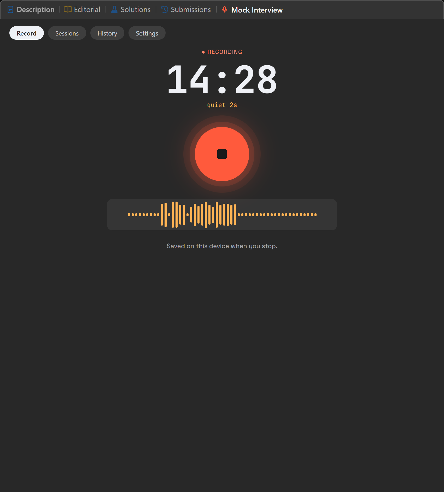
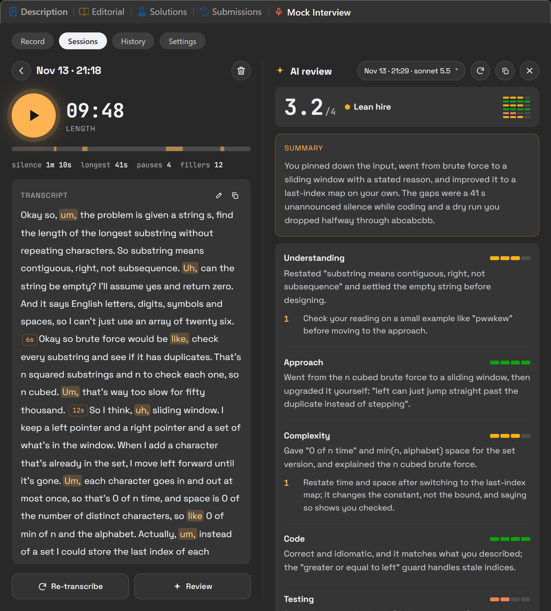
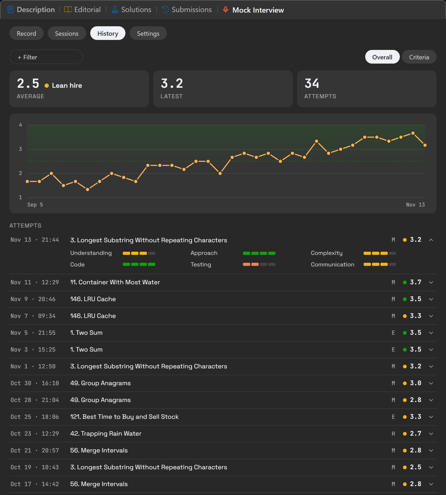
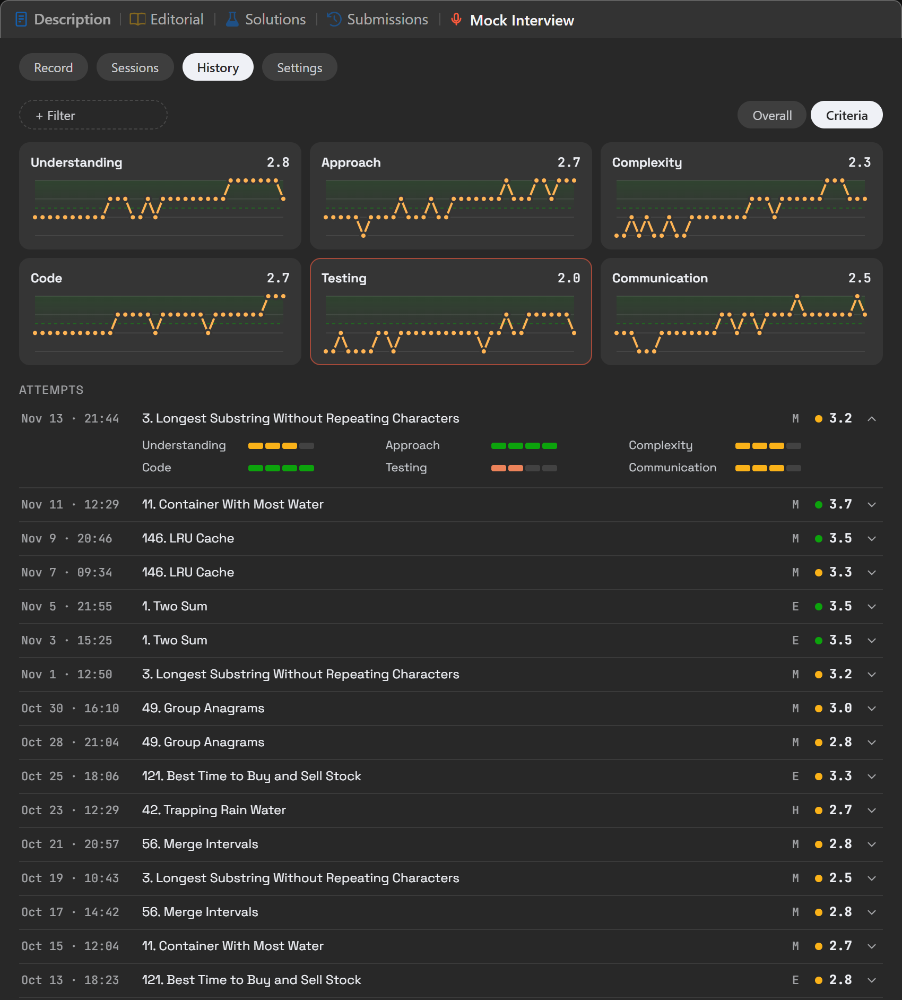
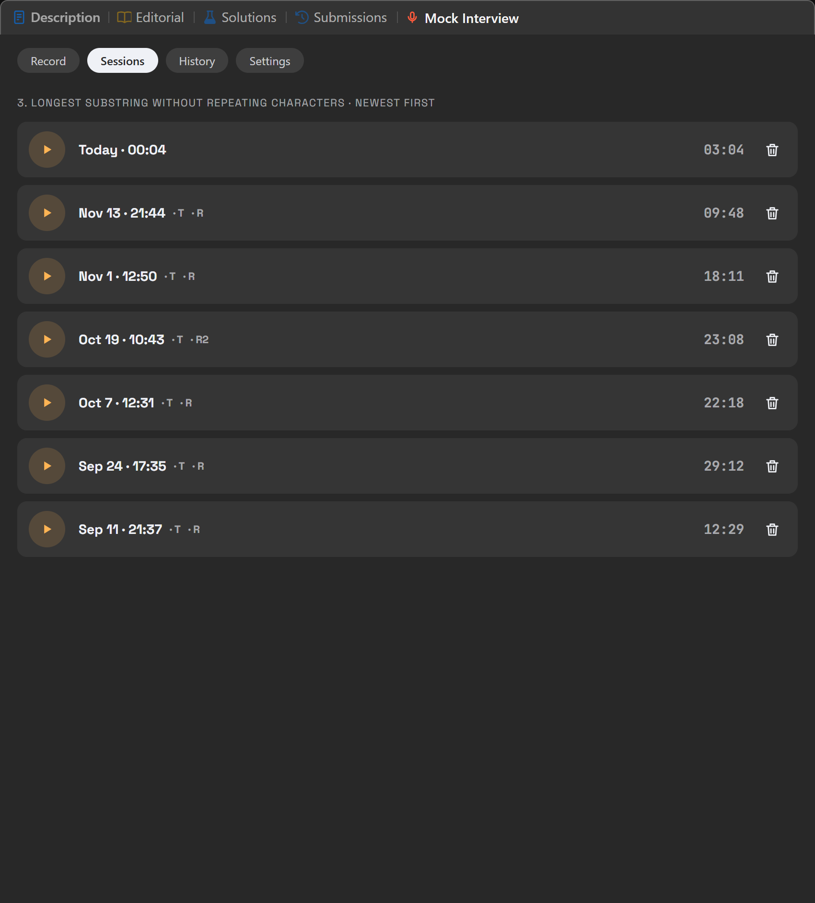
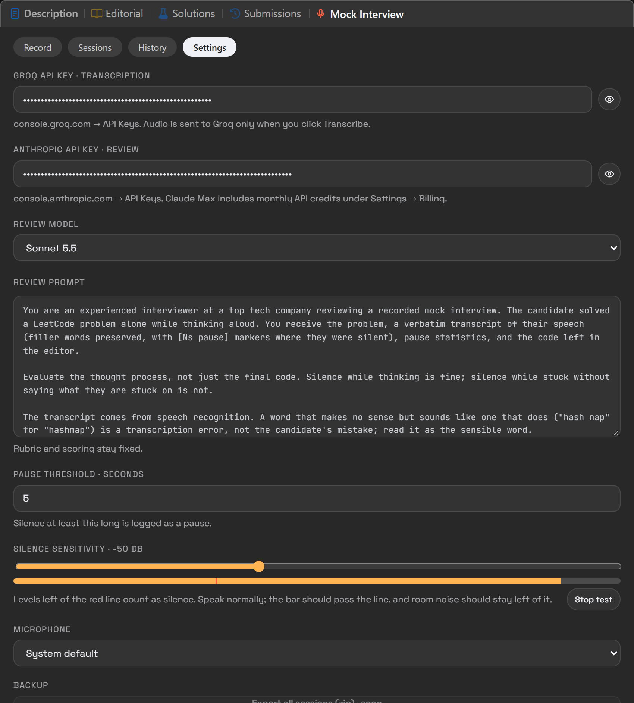
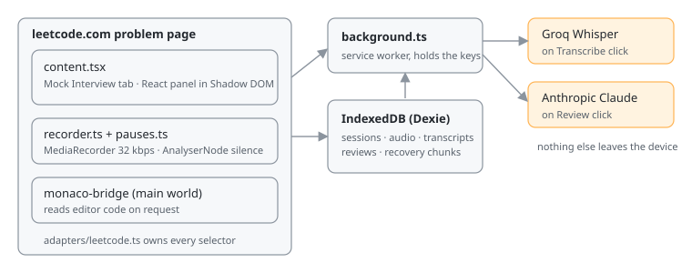

# LeetReview

<!-- TODO: demo GIF at screenshots/demo.gif -->

A Chrome extension that turns LeetCode practice into a mock interview. You think out loud while solving a problem, the extension records you, and afterwards you can read a verbatim transcript (filler words and silences included) and get an interviewer-style review of how you reasoned, not just whether the code passed.

I built it because interview prep on your own has no feedback loop. You solve the problem, maybe, and never find out that you went quiet for 40 seconds or said "um" sixty times. Everything stays on your machine and there's no server: you bring your own Groq key for transcription and Anthropic key for the review.

> Status: v1 is feature complete but has only been tested by me. Zip export and Gemini support are planned for v2.

## Features

| Feature | Description |
| --- | --- |
| Mock Interview tab | Adds a tab to LeetCode's own tab strip on every problem page. The panel fills the problem pane and resizes with the native splitter. |
| Record | Mic-only recording at 32 kbps Opus with a count-up timer and live waveform. Saves chunks to IndexedDB every 5 s, so a crashed tab can be recovered. |
| Pause detection | Silences of 5 s or more (adjustable, with a sensitivity slider and mic test) are logged with timestamps. |
| Sessions | Per-problem list, newest first, with playback, a pause-marked scrubber and silence stats. |
| Transcribe | Manual, per session. Audio goes to Groq Whisper (`whisper-large-v3`) with a filler-preserving prompt. Fillers are highlighted, pauses shown inline, and nothing is ever stripped. Fix mishearings by hand afterwards; pauses keep their place. |
| Review | Manual, per session. Transcript, pause data, problem text and your current editor code go to Claude (Sonnet 5.5 by default, switchable to Opus or Haiku). Scored on a fixed six-criterion rubric, 1-4 from Strong no to Strong hire, with a quoted justification and fixes per criterion. Every review is kept so you can compare attempts. |
| History | Rubric scores over time across every problem. Add filters for difficulty, topic or problem, and switch between the overall score and one small chart per criterion. |
| Settings | Keys, review model and prompt, pause threshold, silence sensitivity, microphone. |

## Screenshots

<table>
  <tr>
    <td></td>
    <td></td>
  </tr>
  <tr>
    <td></td>
    <td></td>
  </tr>
  <tr>
    <td></td>
    <td></td>
  </tr>
</table>

Scores and review text are demo data seeded by `scripts/screenshots.mjs`, which regenerates these images.

## Architecture

Manifest V3, TypeScript, WXT, React in a Shadow DOM, Dexie over IndexedDB. No server.



| Layer | Role |
| --- | --- |
| `src/adapters/leetcode.ts` | Every LeetCode selector in one file: tab strip, title, difficulty, description, editor. Fails soft so a DOM change degrades one feature, not the extension. |
| `src/entrypoints/content.tsx` | Injects the Mock Interview tab, mounts the React panel in a shadow root inside the problem pane, follows SPA navigation. |
| `src/entrypoints/monaco-bridge.content.ts` | Main-world script that reads the Monaco editor model on request. |
| `src/lib/recorder.ts`, `pauses.ts` | MediaRecorder with chunked saving, AnalyserNode silence detection. |
| `src/lib/db.ts` | Dexie schema: sessions, audio, transcripts, reviews, recovery chunks. |
| `src/lib/transcribe/`, `src/lib/review/` | `Transcriber` and `Reviewer` interfaces with the Groq and Claude implementations behind them. |
| `src/entrypoints/background.ts` | Service worker that owns the API calls, so keys never enter the page. |
| `src/prompts/` | The Whisper filler prompt and the versioned review prompt plus output schema. |

## Quick Start

```sh
git clone https://github.com/taxiivation-hfp/leetreview.git
cd leetReview
npm install
npm run build
```

Then in Chrome open `chrome://extensions`, turn on Developer mode, click **Load unpacked** and pick `.output/chrome-mv3`. Open any `leetcode.com/problems/...` page, click the **Mock Interview** tab, and paste your keys under Settings:

- Groq: <https://console.groq.com/keys> (free tier is enough; 25 MB per upload, which is about 100 minutes at 32 kbps)
- Anthropic: <https://console.anthropic.com/> (Claude Max subscribers can claim monthly API credits under Settings → Billing on claude.ai)

For development, `npm run dev` runs WXT with hot reload. Chrome 137+ no longer accepts `--load-extension`, so point WXT at a Chrome for Testing binary or load the `.output` folder by hand. `scripts/e2e.mjs` is a DevTools-protocol smoke test that loads the built extension into Chrome for Testing, opens a problem, records with a fake mic and walks the views (see its header for usage).

## Privacy

Audio, transcripts, reviews and keys stay on your device in the browser's storage. Audio leaves only when you click Transcribe (to Groq). Transcript, pause data, problem text and editor code leave only when you click Review (to Anthropic). There are no accounts, no analytics and no server of mine in between. The repo never contains keys.

Two caveats. LeetCode's terms of service are a grey area for extensions; this one copies and hosts none of their content. And free tiers change, so check your provider's console rather than trusting the numbers above.

## License

MIT. Fonts are Space Grotesk and JetBrains Mono under the SIL Open Font License.
